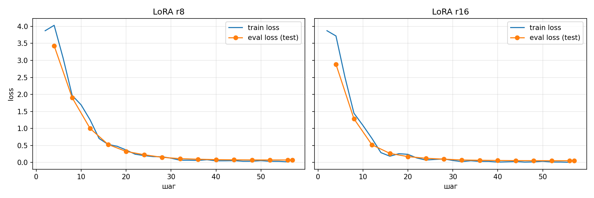

# DSL Query Generator: дообучение Qwen3-4B переводить русский язык в ECQL

Малая модель **Qwen3-4B-Instruct-2507** (4-bit, QLoRA) дообучена LoRA-адаптером переводить
запросы на русском языке во внутренний язык запросов ECQL вымышленной компании «E-Corp».

Домашнее задание курса LLM.

* **Отчёт:** [`notebooks/report.ipynb`](notebooks/report.ipynb). Все выводы сохранены,
  ноутбук читается без запуска.
* **Обучение в Colab (T4):** [`notebooks/train_colab.ipynb`](https://colab.research.google.com/github/AlexIntellySoft/llm-7/blob/main/notebooks/train_colab.ipynb)
* **Веса адаптеров:** [Alex-Popov/qwen3-4b-ecql-lora-r16](https://huggingface.co/Alex-Popov/qwen3-4b-ecql-lora-r16) (основной),
  [Alex-Popov/qwen3-4b-ecql-lora-r8](https://huggingface.co/Alex-Popov/qwen3-4b-ecql-lora-r8)
* **Метрики и ответы модели на тестовой выборке:** [`outputs/metrics.json`](outputs/metrics.json),
  [`outputs/predictions_r16.jsonl`](outputs/predictions_r16.jsonl), [`outputs/predictions_r8.jsonl`](outputs/predictions_r8.jsonl)
* **Проверяющему:** карта «требование → что сделано → где смотреть» в [`ДЛЯ_ПРОВЕРЯЮЩЕГО.md`](ДЛЯ_ПРОВЕРЯЮЩЕГО.md)

## Главное

Тестовая выборка — 36 запросов, которых модель не видела.

| метрика | LoRA r=8 | **LoRA r=16** |
| --- | --- | --- |
| синтаксис ECQL корректен | 100% | 94% |
| верная сущность | 100% | 94% |
| перепутан `ABOVE`/`BELOW` | 0 | 0 |
| элементы SQL в ответе | **0%** | **0%** |
| логически эквивалентен эталону | 64% (23/36) | **72% (26/36)** |
| вложенные запросы (`&&` + `||` со скобками) | 0/6 | **3/6** |
| eval loss в конце обучения | 0.074 | **0.053** |



1. **Синтаксис выучен за 3 минуты на 148 примерах.** `@`, `[]`, `&&` расставлены верно,
   `ABOVE`/`BELOW` не перепутаны ни разу, SQL не появился ни разу.
2. **Оставшиеся ошибки словарные, а не синтаксические.** Модель путает перевод значений и выбор
   редких полей. Пример: «проекты Смирнова» → `'Smirnova'`, потому что в обучении «Смирнова»
   встречается только как женское имя. Ещё: «Нужна таблица…» без `AS TABLE`, потому что формат
   всегда задавался словом «таблицей», и `@item`, который есть в одном обучающем примере.
3. **Ранг r влияет на вложенную структуру.** r=8 теряет скобки во вложенных запросах (0/6), r=16
   их сохраняет (3/6). На простых запросах ранги почти равны. Зато r=16 дважды выдумал
   булево поле `@on_leave IS false`, отсюда 94% синтаксиса против 100%.
4. **Переобучения нет:** loss на тесте снижается вместе с train loss и выходит на плато к
   концу 3-й эпохи.

## Как устроено

```
docs/teacher_prompt.md (правила ECQL + схема полей)
   │  модель-учитель (Claude) → tools/teacher_pairs.py, 184 пары
   ▼
tools/build_dataset.py — каждый эталон проверен парсером src/ecql.py, split 80/20
   ▼
data/train.jsonl (148), data/test.jsonl (36)    {"instruction", "input", "output"}
   │  notebooks/train_colab.ipynb на T4:
   │  src/finetune.py — 4-bit NF4 (bitsandbytes) → LoRA q/k/v/o (PEFT) → trl.SFTTrainer
   ▼
адаптеры r=8, r=16 → Hugging Face Hub; генерация на тесте → src/evaluate.py → outputs/
   ▼
notebooks/report.ipynb (tools/make_report.py) — отчёт по outputs/, без GPU
```

| параметр | значение |
| --- | --- |
| LoRA | r=16, alpha=32 (контроль: r=8, alpha=16), dropout 0.05, `q_proj, k_proj, v_proj, o_proj` |
| обучение | lr 2e-4 cosine, 3 эпохи, батч 2 × накопление 4, fp16, loss только по ответу |
| версии | transformers 5.22, peft 0.21.2, trl 1.16, bitsandbytes 0.50.2 |

## Запуск

Обучение (нужна CUDA, поэтому Colab): открыть [`train_colab.ipynb` в Colab](https://colab.research.google.com/github/AlexIntellySoft/llm-7/blob/main/notebooks/train_colab.ipynb),
выбрать T4 GPU, добавить `HF_TOKEN` в Secrets и выполнить все ячейки. Ноутбук скачивает
`llm7_results.zip` с метриками и ответами модели.

Локально (датасет, отчёт и проверка пайплайна на крошечной модели):

```bash
python3.12 -m venv .venv && .venv/bin/pip install -r requirements.txt
.venv/bin/python -m tools.build_dataset        # проверка пар и split
.venv/bin/python -m tools.smoke_test           # весь пайплайн на tiny-Qwen3, CPU
.venv/bin/python -m tools.make_report && .venv/bin/jupyter nbconvert --to notebook --execute --inplace notebooks/report.ipynb
```
